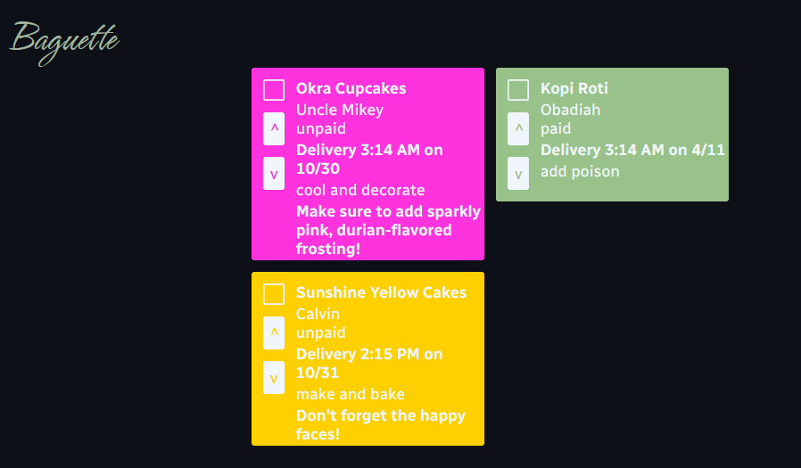

# Baguette
web app for managing a commercial bakery

## Intro
Baguette is a web app for managing a commercial bakery. The [current demo](https://baguette.katanya.dev/demo/v1/) features a dashboard where users can add and manage their bakery orders with the following order details:
* Item name
* Customer Name
* Item delivery time and date
* Item position on dashboard
* Payment status
* Stage of production
* Color-coding, to assign to different bakery members
* An option to add additional notes
All data is saved locally to your browser. Items can be rearranged in their column (moved up and down) temporarily for better clarity, and their original positions will be reset upon page reload.  
Add bakery orders to the Baguette dashboard by pressing the "plus" button in the bottom right corner.

## Tech Stack
All code has been built by [kpoovakan](https://kpoovakan.github.io); no libraries or packages were used.
#### Frontend
* Vanilla JavaScript
* CSS
* HTML
#### Backend
* Vanilla JavaScript with Cloudflare Workers, not NodeJS

## Font Stack
* [Hurricane](https://github.com/google/fonts/tree/main/ofl/hurricane) for headings
* [Radio Canada](https://github.com/google/fonts/tree/main/ofl/radiocanada) for body text

## Credits and Licensing
* Baguette has been built by [kpoovakan](https://kpoovakan.github.io) and is licensed under the [PolyForm Internal Use License 1.0.0](https://github.com/kpoovakan/baguette/blob/main/LICENSE.md).
* Favicon drawn on [Turbowarp](https://turbowarp.org/editor).
* For font credits, see [Font Stack](#font-stack).
* For info about programming languages, see [Tech Stack](#tech-stack).

## Irrational Fun Facts
* Baguette was inspired by a piece of paper on a friend's fridge
* The digits of pi were often used in the testing of Baguette
* The frontend of [Demo v1](demo/v1) took 20 hours to build