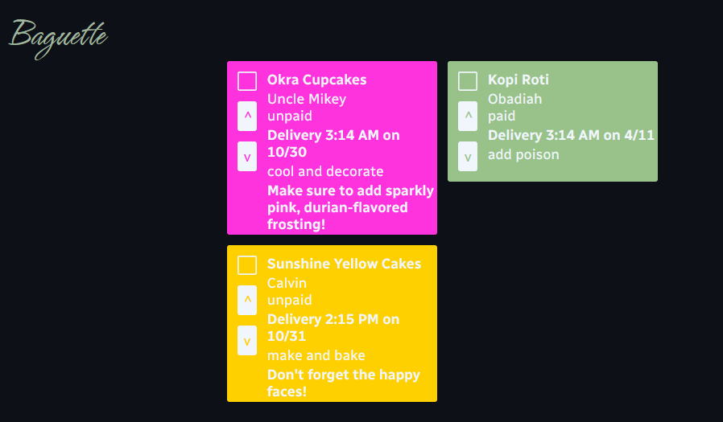

# Baguette
web app for managing a commercial bakery

## Intro
Built with small businesses in mind, Baguette is a web app for managing your commercial bakery. Organize orders and plan baking times for every item, and save all data to the cloud to sync across multiple devices. The [current demo](https://baguette.katanya.dev/) features a dashboard where users can add and manage their bakery orders with the following order details:
* Item name
* Customer Name
* Item delivery time and date
* Item position on dashboard
* Payment status
* Stage of production
* Color-coding, to assign to different bakery members
* An option to add additional notes

Bakery items can be rearranged in their column (moved above or below other items), marked as completed, or edited. Data can be saved to the cloud. Add bakery orders to the Baguette dashboard by pressing the "plus" button in the bottom right corner. The dashboard only shows items for the current day and for the next six days; any items in the future are stored but won't be displayed until they reach the criteria of "current day or next six days".

## Plans
Baguette is completely free for any bakery! Guests have free access to all of Baguette's tools. A guest's saved clouddata may be overrided by other guests or deleted by the developer at any time. This plan is built for testing Baguette as a "demo" and is the default plan when you login. Premium users have free access to all of Baguette's tools, plus exclusive features. This plan includes a private clouddata account specifically for your bakery, so that your bakery planning data will not be overrided by Guest users.

## Tech Stack
All code has been built by [kpoovakan](https://kpoovakan.github.io).
#### Frontend
* Vanilla JavaScript
* CSS
* HTML
#### Backend
* Vanilla JavaScript for code
* Cloudflare Workers and GitHub OAuth for integration

## Font Stack
* [Hurricane](https://github.com/google/fonts/tree/main/ofl/hurricane) for headings
* [Radio Canada](https://github.com/google/fonts/tree/main/ofl/radiocanada) for body text

## Credits and Licensing
* Baguette has been built by [kpoovakan](https://kpoovakan.github.io) and is licensed under the [PolyForm Internal Use License 1.0.0](https://github.com/kpoovakan/baguette/blob/main/LICENSE.md).
* Favicon drawn on [Turbowarp](https://turbowarp.org/editor).
* For font credits, see [Font Stack](#font-stack).
* For info about programming languages, see [Tech Stack](#tech-stack).

## Future Updates
Baguette will receive updates, maintenance, and new features in the future. Check out the [to-do list](indexfiles/todo.md) for an exclusive preview of Baguette's future!